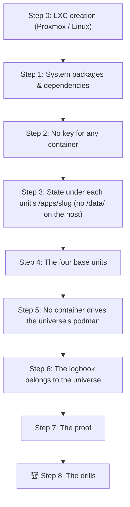

# 📋 Official Step List: Blank LXC Deployment of a Universe's Base Units

> **Perimeter law**: Deployed stack = **the base units** — Vault, Logger, Queue (P1) and Maestro (P2).
> Helm (P2) and P3 client tools are catalogue units, out of scope here.  
> See [`docs/PERIMETERS.md`](./docs/PERIMETERS.md).

> **The slug belongs to the operator.** This procedure is generic: wherever you
> read `<univ_slug>`, substitute the name of your universe. No concrete
> universe ships with this repository — see [`universes/README.md`](./universes/README.md).

This document details the exact, chronological sequence that brings up a Shaper OS universe derived from [`universes/_template/`](./universes/_template/INTENT.md) on a **blank LXC** container (Debian 13, as Rule 11 states; Debian 12 and Ubuntu 24.04 remain usable), up to its **proof**: the four base units of [`univ-minimal`](./universes/univ-minimal/INTENT.md), each one functional Podman holding its application and its own MariaDB server (Rules 4 and 26).

> **Until the base release (11 October 2026)** this guide brought up nine
> containers around an OpenCode bridge and ended on the bridge "taking command"
> of the LXC's podman over SSH. The base units run no engine and no bridge, and
> no container is given the universe's podman: the steps that wired it (2 and 5)
> now say what replaces them, and the success criterion is the proof.

---

## 🎯 Definition of Success (Criterion of Total Accomplishment)
> **The system is deemed successful when, on a blank LXC container, an automated sequence births the four base units and `deploy/proof.sh` exits 0 — the Rule 26 inventory of every unit and one real effect each, read back from its own database — followed by a green lifecycle drill and a green restore drill.** A health endpoint that answers is not in that list: it proves a process is up, never that work happened.
>
> **Three restoration clocks (never say "&lt; 120 s" without them):**
> 1. **Images already in our registry / Podman cache** — **fast** deployment.
> 2. **Images rebuilt or pulled from scratch** — **longer** (network build/pull).
> 3. **Plus a data delta** — proportional to the volume (`sav/`, dumps, GED, files). An empty TEST ≠ a production with years of files.
>
> LXC provisioning / `apt` comes on top. Detail: [`RULES.md`](./RULES.md) Rule 10.

---



---

## 🛠️ The 8 Steps, in Order

### Step 0 — LXC Container Configuration (Proxmox Host)
So that Podman can run without restriction inside the LXC container:
1. Unprivileged LXC container (or privileged, depending on policy).
2. Options enabled in the Proxmox configuration (`/etc/pve/lxc/<ID>.conf`):
   ```text
   features: nesting=1,keyctl=1
   ```
3. On an **unprivileged** container, pass `/dev/net/tun` as well:
   `pct set <ID> --dev0 /dev/net/tun,mode=0666`. Without it every `RUN` step
   of a `podman build` fails inside the container (`pasta … /dev/net/tun: No
   such file or directory`), while `podman run` of a prebuilt image works — a
   container that only runs images looks fit and is not
   ([univ-minimal — host](./universes/univ-minimal/INTENT.md#host)).
4. Start the LXC: `pct start <ID>` then `pct enter <ID>` (a setting changed on
   a running container applies only after `pct reboot <ID>`).

---

> **Four host families, one contract (Rule 11); this document covers the `lxc` shape, families `proxmox` and `lxd`.** The `pct`/Proxmox steps of
> this document do NOT apply as written to a Debian/LXD host: on LXD it is
> `lxc launch` + the `podman-univ` profile + `security.nesting=true`
> (section "Verified from scratch" below, and Rule 11). An agent identifies
> the host's family BEFORE following a container command — V1.13 beta
> finding: the scripts route one family, the law routes four.

### Step 1 — OS Provisioning & Engineering Tools
Run on the blank Debian 13 system:
```bash
apt-get update && apt-get install -y   podman   nftables   iproute2   git   curl   jq   openssl   python3   ca-certificates   nodejs   npm
systemctl enable podman-restart.service
```

`podman`, `nftables`, `jq`, `openssl`, `curl` and `iproute2` (`ss`) are what
the base's `podman-up.sh` needs; `git` and `python3` serve `install-base.sh`
and the image lock; `nodejs` runs `npm test` and the smoke test.
`podman-restart.service` brings the units (`--restart=always`) back after the
universe container restarts.

---

### Step 2 — No key pair for any container

**Nothing to do here.** This step used to make an SSH key pair on the LXC and
add it to root's `authorized_keys`, so that the agent's container could reach
the LXC's podman without a password (Step 5). The base units run no agent, and
no container is given a path to the universe's podman: there is no key to
make. A universe that needs remote administration gets it from its operator's
own access, declared in its `INTENT.md` — never from a unit.

---

<a id="no-host-data-tree"></a>
### Step 3 — Persistent state lives in the universe, not in `/data/`

**Nothing to create by hand here.** This step used to ask for a `/data/` tree
to be created on the host. That was a reading error, and it cost a tester a
hesitation: **`/data/…` are the paths seen *from inside* the containers**,
never directories of the host.

Each base unit keeps its Turbinobash layout under `/apps/<slug>/` of the
universe container — `vault`, `logger`, `queue`, `maestro` — and mounts the
same paths inside its own container:

| In the universe container (what really exists) | What it holds |
| :--- | :--- |
| `/apps/<slug>/etc/mysql/localhost/passwd` | the unit's MariaDB password, `0600`, owned by the unit's account, generated once |
| `/apps/<slug>/sav/mariadb`, `/apps/<slug>/sav/dumps` | the unit's datadir (owned by its engine uid, `0700`) and its dumps |
| `/apps/<slug>/log` | the unit's log (Vault, Logger, Queue) |
| `/apps/<slug>/etc/identity` | the unit's bootstrap and the pin of Vault's key |
| `/apps/vault/etc/vault/` | the master key, the universe identity, the registration records (root-only) |

A universe's persistent state therefore lives **in its own universe
container**, unit by unit, which is what makes a universe movable, backupable
and destroyable in a single gesture. univ-minimal's `podman-up.sh` creates each
unit's declared volumes itself, single directories, before mounting them —
ownership is never changed recursively.

There is consequently **no `chmod 777` to run**: the line that stood here
opened world-writable directories that nobody used.

> **The one-click script obeys this step too.** Until the 2 September audit
> `scripts/shaper-lxc-bootstrap.sh` still ran `mkdir -p /data/{…}` and
> `chmod -R 777 /data/ged /data/workspaces /data/timelines` on the host while
> this page said the opposite, and it seeded a journal under
> `/data/workspaces/<author>/_kovzu/` that nothing in this repository reads.
> The script now creates nothing on the host: the deploy script of the universe
> creates what it mounts, under the universe, before it mounts it
> ([`universes/README.md` §5](./universes/README.md#materialise-before-mount)).
> A guard reads the script for any host `/data` creation, any `chmod 777`, and
> any unquoted slug (`pkg-universe/test/lxc-bootstrap-script.test.js`).

---

### Step 4 — The four base units

> **This is "the base".** A universe derived from the template runs exactly
> four units, and `manifest.json` declares exactly these four: the template
> refuses a fifth until its start and proof are added. The cockpit, the GED,
> the vector store, the tunnel and any engine are catalogue units; each joins
> a universe only as one functional Podman holding its application and its own
> MariaDB server (Rules 4 and 26). The readings of "the base" across this
> tree's history are reconciled in
> [`../docs/architecture/BRICKS.md`](../docs/architecture/BRICKS.md).

From the universe's directory (a copy of `universes/_template/`, outside this
repository — [`universes/_template/AGENT-DEPLOY.md`](./universes/_template/AGENT-DEPLOY.md)),
in `bootOrder`, Vault alone first:

* 🔐 **`<univ_slug>-ctr-vault`** (:8610) — secrets, the universe identity, the units' credentials
* 📜 **`<univ_slug>-ctr-logger`** (:8620) — the evidence each unit delivers, under its own name
* 📬 **`<univ_slug>-ctr-queue`** (:8640) — durable jobs, each run under one attempt
* 🎼 **`<univ_slug>-ctr-maestro`** (:8630) — the declared schedule, submitted to Queue

Each container runs `tini`, the unit supervisor, `mariadbd` as its engine uid
on a private socket with no TCP, and the application as the unit's own uid,
bound to `127.0.0.1`.

```bash
bash deploy/install-base.sh --shaper-repo /root/SHAPER-OS-V1.14 --shaper-commit <revision>
cp cfg-universe.env.example cfg-universe.env      # SHAPER_UNIVERSE, the registry and tag, or the lock
bash deploy/podman-up.sh --preflight
bash deploy/podman-up.sh
bash deploy/base.sh install-renewal-timer.sh
```

---

### Step 5 — No container drives the universe's podman

**Nothing to do here, and nothing to undo on a new universe.** This step used
to wire the OpenCode bridge to the LXC's podman: a key pair made in the agent's
container, its public key added to root's `authorized_keys`, and a `podman`
wrapper copied into the container that ran `ssh root@localhost podman …`. That
gave an AI container root's podman over the universe container that runs it —
every unit, every volume, every database.

Two lessons stay:

> **What goes down is a public key. Never a private key.** The first version of
> this step copied the LXC's **private** key into the agent's container: since
> the matching public key already sat in the LXC's `authorized_keys`, that
> handed the agent the key that opens its own host. Rule 36 says it without
> condition — *"the private key never leaves the Parent"* — and a private key
> does not move, at any level.

> **What holds the power has no door in.** The base units run no engine and no
> bridge. A cognition adapter joins a universe only as a unit meeting Rules 4
> and 26, through Queue, under its own credential — and nothing grants a unit
> the universe's podman.

A universe of the earlier shape that still carries such a wiring keeps it until
its own migration; revoking it is the removal of one tagged line from root's
`authorized_keys` (`agent:<univ_slug>-bridge-opencode`) and of the wrapper
inside that container.

---

### Step 6 — The logbook belongs to the universe, not to the host

**Nothing to do on the host here.** Until the 2 September audit this step
created `/data/workspaces/<first name>/_kovzu/JOURNAL.md` on the host — a
journal seeded with a port list and an operator's first name, in the very host
tree Step 3 says nothing creates, and that nothing in this repository reads.
An operator's name in a tracked file is exactly what the Boot Contract forbids
(10b), and a host path the containers do not mount is state that survives no
rebuild.

If a universe keeps a logbook, that is the universe's decision: it is declared
in that universe's `INTENT.md`, it lives in a volume that universe owns, and
the deploy script that mounts the volume creates it first
([`universes/README.md` §5](./universes/README.md#materialise-before-mount)).
This guide names no path for it and no author.

---

### Step 7 — The proof

```bash
bash deploy/proof.sh
```

It exits 0 only when every unit passes the Rule 26 inventory — application and
MariaDB in the same container, private socket, no TCP listener, DML-only
grants, the password file `0600`, the administrative paths not writable by the
unit — holds its own identity in Vault, and proves one real effect read back
from its own database ([what it checks](./universes/univ-minimal/INTENT.md#proof)).
`node --test test/socle-live.test.js` is a smoke test after the start, never
the proof.

---

### 🏆 Step 8 — The drills

```bash
bash deploy/base.sh lifecycle-drill.sh    # restart, re-run, recreation: nothing lost
bash deploy/base.sh restore-drill.sh      # each unit's dump into fresh volumes, served back
```

Only after both is the universe proven: the proof shows it works now, the
drills show it survives a restart, a recreation and the loss of a volume.

---

## ⚡ 1-Click Bootstrap Script (`scripts/shaper-lxc-bootstrap.sh`)

Steps 1, 4 and 7 are condensed in the executable script
`software/scripts/shaper-lxc-bootstrap.sh`. Steps 2, 3 and 5 create nothing,
and step 6 is no longer a host gesture: the script makes no key, wires no
bridge and seeds no journal. The script needs the universe slug, and a
universe already derived from `software/universes/_template/` at `UNIV_DIR`
(default `/apps/<univ_slug>`), with its manifest and `cfg-universe.env`
written: the registry and tag, or the image lock, are the operator's, and the
images must be published (Step 4.1 of the
[runbook](../docs/agent/RUNBOOK-EXPLICIT.md)). When the universe has no `base/`
yet, the script installs it from its own checkout at `HEAD`; then it runs the
preflight, the birth, the renewal timer and the proof, and stops on the first
red. On a fresh LXC container:

```bash
git clone https://github.com/xavdp-pro/SHAPER-OS-V1.14.git /root/SHAPER-OS-V1.14
cd /root/SHAPER-OS-V1.14
cp -r software/universes/_template /apps/<univ_slug>   # then its manifest and cfg-universe.env
UNIV_SLUG=<univ_slug> bash software/scripts/shaper-lxc-bootstrap.sh
```

> Until the 2 September audit this block read `cd /root/SHAPER-OS` then
> `bash scripts/shaper-lxc-bootstrap.sh`: there is no `scripts/` at the
> repository root (it is `software/scripts/`), and the script halts without
> `UNIV_SLUG`, which no line here named. The script resolves `software/`
> from its own location, so it runs from any directory; a universe it cannot
> find is a halt that says so, not a warning that scrolls by. Until the base
> release it started `software/universes/$UNIV_SLUG` — a universe inside the
> repository, with the earlier template's copied script.

**Execution time observed in this precise context**: images already present in the local cache, empty universe with no data to restore, LXC provisioning and `apt` **not included**.
This value is an observed measurement, **not a commitment**: it holds only for this exact context. See Rule 10 (three clocks) before quoting it anywhere.  
**Result**: Universe born and proven (`deploy/proof.sh` exit 0); the two drills follow.

---

## Verified from scratch — 23 August 2026, gbs-test

A blank Debian LXC, the public repository, nothing else. What it took, and what
it found.

### The container itself

```bash
lxc launch <debian-image> univ-<slug>
lxc config set univ-<slug> security.nesting=true    # required
lxc restart univ-<slug>
```

**`security.nesting=true` is not optional.** Podman inside an LXD container
otherwise fails on the first image it tries to run:

```
crun: remount `/var/lib/containers/storage/overlay/…/merged`: Permission denied
```

The message says nothing about nesting, which is why it belongs here.

### Inside it

```bash
apt-get install -y podman nftables git curl jq nodejs npm openssh-server rsync
git clone --depth 1 https://github.com/xavdp-pro/SHAPER-OS-V1.14.git
cd SHAPER-OS-V1.14/software
TAG="v1.7.1-$(git -C .. rev-parse --short HEAD)"
for b in vault logger queue maestro bridge-opencode; do
  podman build -q -f bricks/brick-$b/Containerfile -t "localhost/shaper-$b:$TAG" .
done
cp -r universes/_template universes/univ-<slug>-test   # then specialize INTENT + manifest + deploy/env
cd universes/univ-<slug>-test && ENV_FILE=deploy/env ./deploy/podman-up.sh
```

> *(Dated record — 23 August 2026. The `localhost/shaper-$b:$TAG` names above
> predate the unified image ladder of V1.13.1: today the build publishes
> `<registry>/shaper/brick-*:<tag>` and the deploy resolves the same — see
> `scripts/deploy-image-resolve.sh`. The five bricks, `deploy/env` and the
> template's own `podman-up.sh` predate the base release of 11 October 2026:
> today the template installs univ-minimal's four units under `base/` and runs
> them — Steps 4 to 8 above.)*

Result: **five containers healthy**, a job injected into the queue reaching
`COMPLETED`, and `/api/vitals` answering with evidence.

### The hidden dependencies clean-sheet runs found

None of them was visible on a workstation, and each broke a fresh install.

1. **`sav/queue` was never created** while the queue container mounts it.
   Invisible on a universe already running, fatal on a new one.
2. **The vault bootstrap called host `npm`.** A blank LXC has podman and git,
   not node. It now runs inside the vault image, which already carries the
   runtime.
3. **`bridge-opencode` copied a gitignored binary** that no longer existed on
   any machine. The image had been unreproducible everywhere, including where it
   was being built. The CLI is now fetched during the build, version-pinned, and
   the build runs `--version` so a bad fetch fails the build.
4. **A mandatory GED test read a gitignored PDF corpus.** It passed only on the
   workstation that had generated the corpus and failed in a public clone. The
   unit test now generates its minimal vector-PDF fixture in memory; ignored
   measurement corpora remain optional.
5. **OpenCode session metadata did not set the headless working directory.** A
   framed job reached the model, then waited forever on an
   `external_directory` permission even though the bind mount was writable and
   `bash=allow`. OpenCode 1.18.18 declares `directory` as a query parameter on
   session create, lookup, prompt, and abort; the bridge must carry the same
   encoded perimeter on all four calls. It must then observe `/global/event`
   (unwrapping `payload`), because `/event` is directory-scoped and would hide
   terminal events from sessions running in other perimeters.
6. **A zero-secret Vault bootstrap wrote no file.** The command announced
   success, but `VaultStore` persisted only when `setSecret` was called; the next
   boot therefore initialized again. Bootstrap now materializes an empty
   storage object, so “initialized and empty” is durable and distinguishable
   from “never initialized”.
7. **The Vault storage file inherited the process umask (`0644`).** Encryption
   protects values, but it does not authorize local readers. Creation, every
   persistence, and loading an older store now enforce owner-only mode `0600`;
   the clean-sheet proof must verify the mode and a second deploy without
   bootstrap.

### Model speed is advisory until measured locally

The free model list rotates, and hosted capacity changes faster than this
document. Internet tokens/second data may order candidates, but deployment must
run a bounded ping from the target LXC. On 25 August 2026, Nemotron 3.5
Lightning led a public speed leaderboard yet timed out twice on `gbs-test`;
MiMo V2.5 answered locally and was selected. Record both outcomes and the
timestamp; never turn that observation into a permanent global default.

> The lesson worth keeping: a workstation accumulates the answers to questions
> the repository never asked. Only a blank machine asks them all.

### Exact proof is part of the contract

A terminal agent status is necessary but insufficient. The controller must
inspect the artifact independently. For byte-exact claims, compare against
explicitly generated expected bytes with `cmp`; shell command substitution
removes trailing newlines, so `test "$(cat file)" = value` cannot prove newline
semantics. The V1.7 clean-sheet run deliberately retained one rejected
`COMPLETED` job that exposed this proof error before a corrected job passed.
